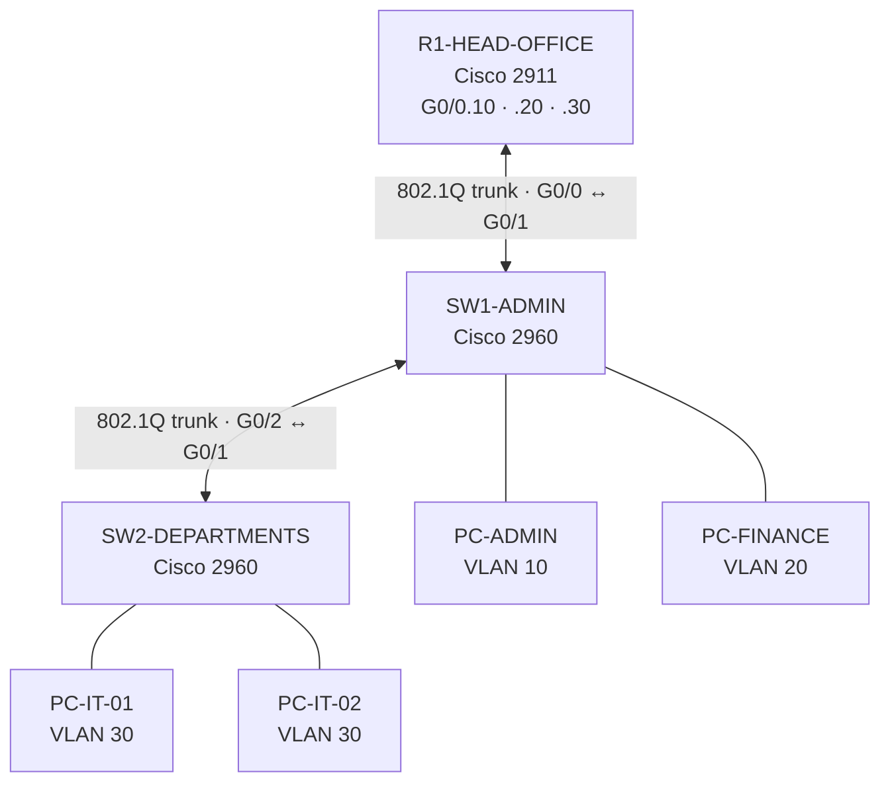

# Enterprise LAN Design, Implementation and Security

Project status

**Status:** Implemented and technically verified  
**Environment:** Cisco Packet Tracer simulation  
**Devices:** 1 Cisco 2911 router, 2 Cisco 2960 switches, 4 end hosts

## Project objective

Design, configure, harden, and verify a small enterprise LAN with departmental segmentation, controlled inter-VLAN communication, automatic IPv4 addressing, and secure remote device administration.

## Topology

See [topology.mmd](topology.mmd) for the editable Mermaid source.

## Network design

| VLAN | Department / purpose | IPv4 subnet | Default gateway |
|---:|---|---|---|
| 10 | ADMIN | 192.168.10.0/24 | 192.168.10.1 |
| 20 | FINANCE | 192.168.20.0/24 | 192.168.20.1 |
| 30 | IT and switch management | 192.168.30.0/24 | 192.168.30.1 |
| 999 | PARKING (unused switch ports) | No user subnet | None |

Switch management addresses: SW1 **192.168.30.2/24**, SW2 **192.168.30.3/24**.

## Implemented capabilities

- VLAN-based departmental segmentation and 802.1Q trunking.
- Router-on-a-stick inter-VLAN routing on R1.
- DHCP pools for ADMIN, FINANCE, and IT; addresses .1–.20 in each subnet are excluded.
- Extended ACL policy blocks ADMIN-to-FINANCE and FINANCE-to-ADMIN IP traffic while permitting other IP traffic.
- SSH version 2 remote management using local `networkadmin` accounts with privilege level 15.
- PVST spanning tree operation.
- PortFast and BPDU Guard on PC-facing access ports.
- Unused switch access ports moved to VLAN 999 and administratively shut down.
- Configurations saved to startup-config on all three network devices.

## Verification summary

| Test | Observed result |
|---|---|
| ADMIN ↔ FINANCE | Blocked in both directions as intended |
| ADMIN → IT | Successful |
| FINANCE → IT | Successful |
| IT → router and switch management IPs | Successful |
| SSH to R1, SW1, SW2 | Successful; privilege level 15 on each |
| Router subinterfaces | All three up/up |
| SW1/SW2 trunks | 802.1Q trunking; VLANs 1, 10, 20, 30, 999 forwarding |
| Unused switch ports | VLAN 999 and disabled |
| Configuration persistence | Running configurations copied to startup-config on all devices |

Detailed evidence and limitations are in [the engineering report](docs/engineering-report.md) and [verification matrix](docs/verification-matrix.md).

## Repository contents

- `docs/engineering-report.md` — design, implementation, security, tests, and limitations.
- `docs/verification-matrix.md` — recorded validation results.
- `docs/addressing-plan.md` — VLAN and IP plan.
- `topology.mmd` — editable Mermaid topology.
- `configs/` — sanitized configuration reference snippets, not unredacted device backups.
- `linkedin-post.md` — project announcement draft.

## Important engineering notes

- The department policy is implemented with a **stateless extended ACL**, not a stateful firewall.
- SSH uses local device accounts; centralized AAA is not configured.
- Port security (sticky MAC / maximum MAC addresses) was not configured and is not claimed as a project feature.
- Trunks currently use native VLAN 1 and allow VLANs 1–1005. Restricting the allowed VLAN list and moving the native VLAN to an unused VLAN are possible future hardening tasks; they were not applied during this verified build.
- This is a Packet Tracer simulation, not a live production deployment. Results should be revalidated on physical hardware before any production use.

## Lab file

The Packet Tracer file is named `Enterprise-LAN-Secure-Departmental-Network.pkt` in the lab workspace. It has not been attached to this repository in this publication.
